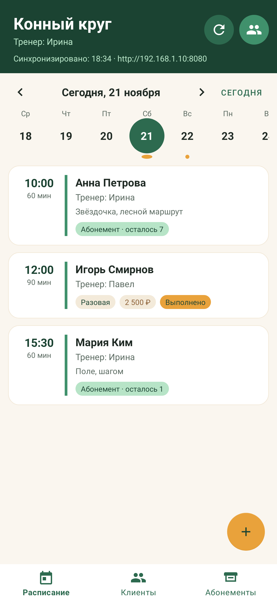
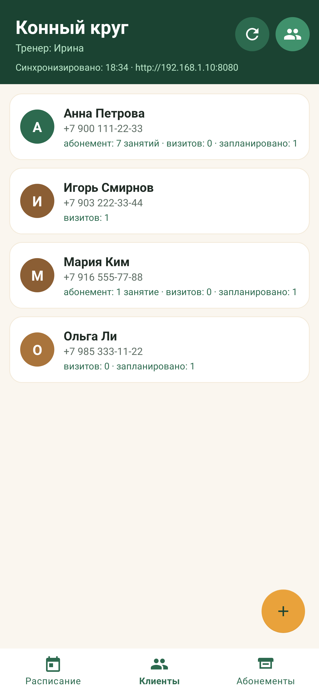
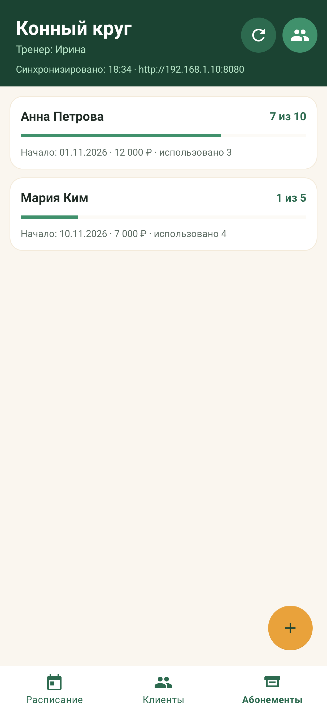
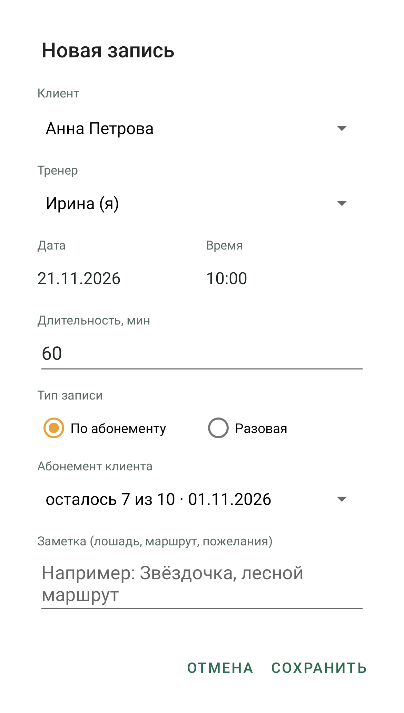

# Конный круг 🐴

[](https://github.com/baxbani4-bit/konny-krug/actions/workflows/android.yml)
[](https://github.com/baxbani4-bit/konny-krug/releases/latest)

**Скачать APK:** [konny-krug-1.0.apk](https://github.com/baxbani4-bit/konny-krug/releases/latest/download/konny-krug-1.0.apk)

Android-приложение для тренеров конных прогулок: календарь записи клиентов, абонементы и разовые занятия, **общее расписание на двух тренеров с синхронизацией** — каждый видит, кто и когда записан к коллеге.

<p align="center">
  
</p>

## Что умеет

| Возможность | Как это работает |
|---|---|
| 📅 Календарь по дням | Лента дней на 2 недели, стрелки ‹ ›, кнопка «Сегодня». Точка под датой — есть записи, широкая точка — 2+ записи |
| 🧾 Две вкладки записей | «По абонементу» (списывается занятие) и «Разовая» (фиксируется цена) |
| 🎟 Абонементы | Пакет занятий на клиента: всего / использовано / осталось, стоимость, дата начала. Остаток виден прямо в списке |
| 👥 Клиенты | Имя, телефон, заметка (лошадь, уровень, особенности), число визитов и запланированных занятий |
| ✅ Статусы | Запись можно отметить выполненной (списание с абонемента) или отменить (возврат занятия) |
| 👩‍🦰 Два тренера | В шапке — «Тренер: Ирина». В каждой строке расписания указан тренер и цветная полоса его цвета. Режим записи на colleague тоже работает |
| 🔄 Синхронизация | Обмен с общим сервером клуба: отправка своих изменений → получение изменений коллеги. Работает и офлайн: копит изменения и досылает при связи |
| 🛠 Офлайн-режим | Всё хранится локально, интернет нужен только для обмена с коллегой |

## Скриншоты

| Расписание | Клиенты | Абонементы | Новая запись |
|---|---|---|---|
|  |  |  |  |

В расписании видно цвет тренера и подпись «Тренер: Павел» на записи коллеги — так работает общее расписание.

## Установка приложения

1. Взять готовый файл `dist/konny-krug-1.0.apk` из репозитория (или из артефактов GitHub Actions).
2. Перекинуть на телефон, открыть, разрешить установку из неизвестных источников.
3. При первом запуске указать имя тренера и адрес сервера клуба.

Требования: Android 7.0+ (minSdk 24), интернет — по желанию.

## Как включить общее расписание на двоих

Синхронизация сделана как «свой сервер»: приложение не зависит от Google-аккаунтов и сторонних сервисов, поэтому подходит и в клубе, где просто нет нормального интернета, и в облаке.

### Вариант 1. Сервер в локальной сети (самый быстрый)

```bash
cd server
node server.js          # нужен Node.js 18+
```

1. Узнать IP компьютера в Wi-Fi клуба: `ipconfig` (Windows) или `ifconfig`/`ip a` (mac/Linux). Например `192.168.1.10`.
2. В приложении у **обоих тренеров**: профиль (иконка справа сверху) → «Адрес общего сервера» = `http://192.168.1.10:8080` → «Проверить связь» → «Сохранить».
3. Тренер А записывает клиента и жмёт синхронизацию (круглая стрелка в шапке). Тренер Б жмёт синхронизацию — запись появилась у него с пометкой «Тренер: А».

Проверить, что данные на сервере, можно в браузере: `http://192.168.1.10:8080/` — там живая таблица всех записей.

### Вариант 2. Облако (работает из любой точки)

Сервер — один файл без зависимостей, поэтому разворачивается где угодно:

* **Render / Railway / Fly.io** — бесплатный тариф: Node.js, команда запуска `node server/server.js`.
* **VPS** — `node server/server.js` под `systemd` или `pm2`.
* **Туннель к домашнему компьютеру** — `ngrok http 8080` и адрес вида `https://xxxx.ngrok-free.app`.

Адрес сервера вписывается в профиле так же, как в варианте 1.

### Как устроена синхронизация

```
телефон тренера A                     сервер                       телефон тренера B
      │  POST /api/push (свои изменения)  │                                │
      ├──────────────────────────────────►│  слияние по updatedAt          │
      │◄─────────────────────────────────┤  (last write wins)             │
      │  GET /api/pull?since=<курсор>     │                                │
      │                                   │◄───────────────────────────────┤
      │  все записи всех тренеров в одном «круге» (room = club)            │
```

* Каждая запись/клиент/абонемент имеет `updatedAt` и флаг `dirty` (локально изменён).
* При синхронизации сначала отправляются `dirty`-записи, затем забираются все изменения сервера после курсора последней синхронизации.
* Конфликты решаются по времени изменения: побеждает более свежая версия. Удаление — «мягкое» (`deleted = true`), чтобы оно тоже доехало до коллеги.
* Сервер хранит данные в `server/data.json` — его достаточно бэкапить.

### API

| Метод | Путь | Описание |
|---|---|---|
| GET | `/api/health` | проверка связи |
| POST | `/api/push` | тело: `{room, trainerId, trainers[], clients[], subscriptions[], lessons[]}` |
| GET | `/api/pull?room=club&since=<курсор>` | изменения сервера после курсора |
| GET | `/` | веб-панель с общим расписанием |

## Сборка из исходников

```bash
# нужен JDK 17 и Android SDK 34 (или откройте проект в Android Studio Ladybug+)
./gradlew assembleDebug          # APK: app/build/outputs/apk/debug/app-debug.apk
./gradlew assembleRelease        # APK: app/build/outputs/apk/release/app-release.apk
./gradlew testDebugUnitTest      # 13 тестов: данные, запуск экранов (Robolectric) и синхронизация
```

Release-сборка подписана debug-ключом, чтобы APK ставился на телефон без настройки keystore. Для публикации в Google Play замените `signingConfig` в `app/build.gradle.kts` на свой ключ.

## Структура

```
app/src/main/java/ru/konnykrug/trainer/
├── MainActivity.kt        экраны, диалоги записи/клиента/абонемента, синхронизация
├── Adapters.kt            списки расписания, клиентов, абонементов
├── Dates.kt               даты и деньги (21.11.2026 ↔ 2026-11-21)
└── data/
    ├── Models.kt          Trainer, Client, Subscription, Lesson + JSON
    ├── Store.kt           локальное хранилище (SharedPreferences + JSON)
    └── Sync.kt            push/pull, слияние по updatedAt
server/server.js           сервер синхронизации (Node.js, без зависимостей)
docs/                      документация
dist/                      готовые APK
```

## Ограничения и что дальше

* Авторизации на сервере нет — он рассчитан на доверенную сеть клуба или закрытый туннель. Если планируете выставлять в интернет, добавьте токен: в `server.js` одна проверка заголовка и поле «токен» в профиле приложения.
* Нет push-уведомлений: изменения подтягиваются при открытии приложения и по кнопке синхронизации.
* Идеи на будущее: напоминания клиентам по SMS/WhatsApp, отчёты по выручке за месяц, загрузка фото лошадей, расписание лошадей.

## Лицензия

MIT — пользуйтесь и меняйте под свой клуб.
